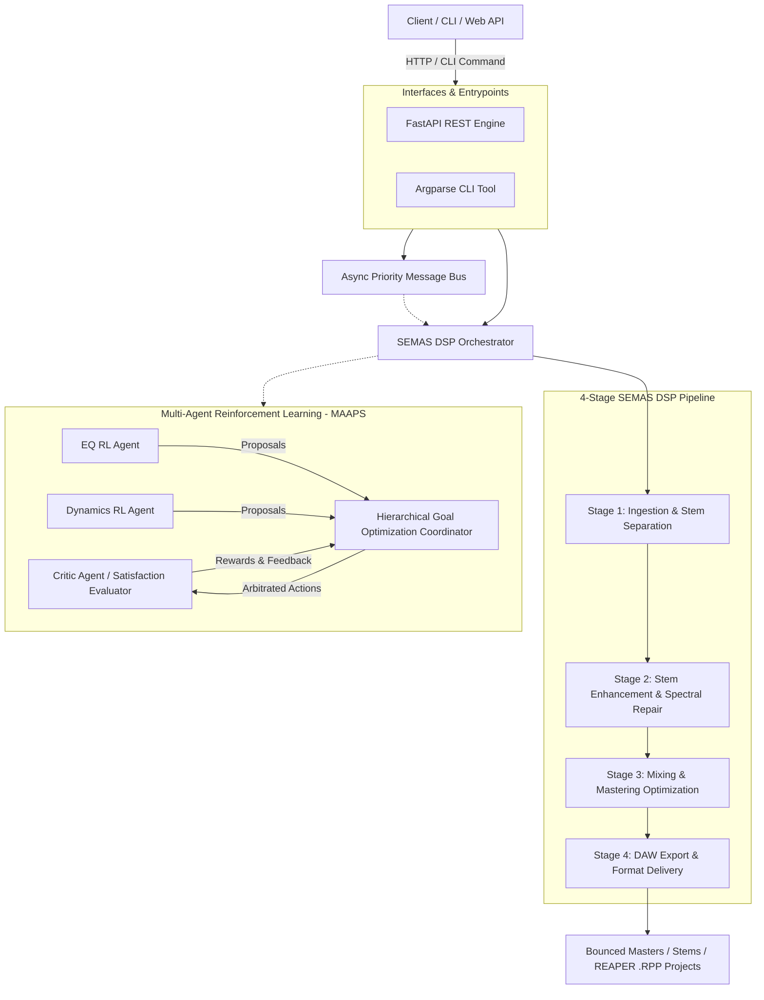

# ETHOS Core

[](https://www.python.org/downloads/)
[](https://github.com/astral-sh/ruff)
[](https://opensource.org/licenses/MIT)

> A Python framework that runs an audio file through a 4-stage chain of small DSP "agents" (analysis, stem processing, mix/master, export) and writes a REAPER project. Many stages are simplified or placeholders; see [Implementation status](#implementation-status).

---

## Table of Contents

- [Overview](#overview)
- [System Architecture](#system-architecture)
- [Core Capabilities](#core-capabilities)
  - [4-Stage DSP Production Pipeline (21 Specialized Agents)](#4-stage-dsp-production-pipeline-21-specialized-agents)
  - [Multi-Agent Reinforcement Learning (MAAPS & HGO)](#multi-agent-reinforcement-learning-maaps--hgo)
  - [Event-Driven Asynchronous Message Bus](#event-driven-asynchronous-message-bus)
- [Installation & Setup](#installation--setup)
- [Command Line Interface (CLI)](#command-line-interface-cli)
- [REST API Reference](#rest-api-reference)
- [Docker & Kubernetes Deployment](#docker--kubernetes-deployment)
- [Testing & Quality Verification](#testing--quality-verification)
- [Repository Organization](#repository-organization)
- [License](#license)

---

## Overview

**ETHOS Core** is a research prototype. It analyses a track (BPM, key, sections), optionally separates stems with Demucs, applies NumPy/SciPy processing per stem, does a basic master, and exports a REAPER `.RPP` project, markers and metadata. An experimental RL layer (critic network, EQ and dynamics agents, a goal coordinator) is included but is not wired into the main pipeline.

## Implementation status

Checked line by line on 2026-10-31. "Simplified" means the code does something much smaller than the agent name suggests.

| Agent | What the code actually does | Evidence |
|---|---|---|
| AudioAnalysisAgent | BPM, key, spectral features, sections, dynamic range | `stage1/audio_analysis_agent.py` |
| StemSeparatorAgent | Calls Demucs `htdemucs` **only if Demucs is installed**; it is not a dependency, so by default separation logs an error and returns nothing | `stage1/stem_separator_agent.py:81-82`, `pyproject.toml` |
| SpectralRepairAgent | STFT magnitude blended 70/30 with a Gaussian-smoothed copy; output quality scores are fixed multipliers (`×1.1`, `×0.7`), not measurements | `stage2/spectral_repair_agent.py` |
| HarmonicEnrichmentAgent | `tanh` saturation plus a high-passed `tanh` exciter | `stage2/harmonic_enrichment_agent.py:30,63-71` |
| DynamicEnhancementAgent | Sample-wise static compression/expansion (no attack/release) | `stage2/dynamic_enhancement_agent.py:68-91` |
| TransientShapingAgent | Hilbert envelope based transient/sustain split | `stage2/transient_shaping_agent.py:107-118` |
| StereoEnhancementAgent | Mid/side width; mono → pseudo-stereo with a 1 ms delay | `stage2/stereo_enhancement_agent.py:81-93` |
| MixEngineerAgent | Returns mix parameters from a template; all stems panned centre; genre fixed to Pop | `stage3/mix_engineer_agent.py:46,66-71` |
| MasteringAgent | 30 Hz high-pass, sample-wise compression, `np.clip` limiter, then RMS-based gain. Gain is applied **after** the limiter, so the ceiling can be exceeded | `stage3/mastering_agent.py:49-60` |
| LoudnessOptimizerAgent | RMS − 23 dB used as a LUFS estimate. **Not** EBU R128 / ITU-R BS.1770 (no K-weighting or gating) | `stage3/loudness_optimizer_agent.py:23-24` |
| FrequencyBalanceAgent | One 2nd-order 20 Hz Butterworth high-pass. The other EQ bands are comments. **Not** linear-phase | `stage3/frequency_balance_agent.py:24-34` |
| GenreOptimizerAgent | Broadband gain changes labelled "shelf" | `stage3/genre_optimizer_agent.py:46-56` |
| ReferenceMatchingAgent | Matches RMS level only (no spectral matching) | `stage3/reference_matching_agent.py:26-33` |
| DAWGeneratorAgent | Writes a REAPER `.RPP` project | `stage4/daw_generator_agent.py` |
| MarkerCreatorAgent | Section markers/regions, CUE export | `stage4/marker_creator_agent.py` |
| FormatConverterAgent | WAV/FLAC via soundfile; MP3/OGG via `ffmpeg` subprocess | `stage4/format_converter_agent.py:37-52` |
| MetadataExporterAgent | JSON and XML reports | `stage4/metadata_exporter_agent.py` |
| TempoMapAgent | Constant-BPM map with a point at each section start | `stage4/tempo_map_agent.py:24-28` |
| MIDIGeneratorAgent | Click-track MIDI. Audio-to-MIDI transcription is a **placeholder** | `stage4/midi_generator_agent.py:24-30` |
| MetadataExtractorAgent, QualityEnhancementAgent | Metadata tagging; chain of the stage-2 steps | `stage1/…`, `stage2/…` |

---

## System Architecture



---

## Core Capabilities

### 4-Stage DSP Pipeline (21 agents)

The orchestrator initialises 21 agents (verified: `SEMASOrchestrator().agents` has 21 entries) in four stages. Names below are the module layout; see the status table above for what each does.

```
src/ethos/agents/dsp/
├── stage1/  # Ingestion, Analysis & Separation
│   ├── AudioAnalysisAgent       (BPM, key, spectral centroid, sections, dynamic range)
│   ├── StemSeparatorAgent      (Demucs htdemucs if installed: vocals, drums, bass, other)
│   └── MetadataExtractorAgent   (Musical, technical, and structural metadata tagging)
│
├── stage2/  # Stem Enhancement & Restoration
│   ├── QualityEnhancementAgent  (chains the stage-2 steps)
│   ├── TransientShapingAgent    (Drum punch & percussive attack preservation)
│   ├── StereoEnhancementAgent   (Mid/Side widening & psychoacoustic pseudo-stereo)
│   ├── SpectralRepairAgent      (STFT magnitude smoothing)
│   ├── HarmonicEnrichmentAgent  (Aural exciter & tape warmth)
│   └── DynamicEnhancementAgent  (sample-wise compression/expansion)
│
├── stage3/  # Mixing & Mastering
│   ├── MixEngineerAgent         (template mix parameters)
│   ├── MasteringAgent           (HPF, compression, clip limiter, RMS gain)
│   ├── LoudnessOptimizerAgent   (RMS-based loudness estimate)
│   ├── FrequencyBalanceAgent    (20 Hz high-pass only)
│   ├── GenreOptimizerAgent      (broadband gain per genre)
│   └── ReferenceMatchingAgent   (RMS level match to a reference)
│
└── stage4/  # Export & Delivery
    ├── DAWGeneratorAgent        (Automated Cockos REAPER .RPP project generation)
    ├── MarkerCreatorAgent       (Structure markers & section region tags)
    ├── FormatConverterAgent     (Bitrate & format transcoding: WAV, FLAC, MP3, OGG)
    ├── MetadataExporterAgent    (JSON & XML metadata reporting)
    ├── TempoMapAgent            (Tempo maps & click track alignment)
    └── MIDIGeneratorAgent       (click track; transcription is a placeholder)
```

### Multi-Agent Reinforcement Learning (MAAPS & HGO)

For ambiguous mixing decisions where agents disagree (e.g., boosting high frequencies for vocal clarity vs. controlling harshness):
- **Audio Ontology**: Structured semantic knowledge model mapping subjective perceptual attributes (`CLARITY`, `WARMTH`, `PUNCH`, `HARSHNESS`, `MUD`) to actionable DSP frequency bands.
- **Hierarchical Goal Optimization (HGO)**: coordinator that arbitrates competing agent proposals using an ordered goal hierarchy, priority weights and a compromise weight (`rl/hgo_coordinator.py:92-130`).
- **Critic Agent**: a small PyTorch MLP that scores audio feature vectors (`rl/critic_agent.py:37-62`). No trained weights are included.

### Event-Driven Asynchronous Message Bus

All agents communicate over a decoupled, in-memory asynchronous publish/subscribe message bus (`ethos.core.message_bus`) supporting priority queues (`CRITICAL`, `HIGH`, `NORMAL`, `LOW`) and pattern/wildcard routing (`analysis.*`, `stage2.complete`).

---

## Installation & Setup

ETHOS Core uses **`uv`** for environment management.

### Prerequisites
- Python `>=3.10, <3.13` (3.12 recommended)
- `uv` package manager (`curl -LsSf https://astral.sh/uv/install.sh | sh` or `winget install astral-sh.uv`)
- `libsndfile` and `ffmpeg` (for multi-format audio I/O)
- Optional: `pip install demucs` — without it, stem separation does nothing

### Install Dependencies

```bash
# Clone the repository
git clone https://github.com/sgm-audio/ethos-core.git
cd ethos-core

# Sync virtual environment with development dependencies
uv sync --extra dev
```

---

## Command Line Interface (CLI)

The unified `ethos` CLI exposes quick-action workflows directly from the terminal:

### 1. Analyze Audio File
Inspect duration, sample rate, BPM, key, dynamic range, and section boundaries:
```bash
uv run ethos analyze path/to/track.wav
```

### 2. Full 4-Stage DSP Processing
Execute stem separation, restoration, mixing, mastering, and REAPER project generation:
```bash
uv run ethos process input_track.wav \
  --output ./production_output \
  --profile aggressive \
  --format streaming \
  --daw reaper
```

### 3. Launch REST API Server
```bash
uv run ethos serve --host 0.0.0.0 --port 8000
```

---

## REST API Reference

When launched via `ethos serve`, the FastAPI backend exposes interactive OpenAPI documentation at `http://localhost:8000/docs`.

### Core Endpoints

| Method | Endpoint | Description |
|---|---|---|
| `GET` | `/` | API version and platform status |
| `GET` | `/health` | Liveness probe; reports the number of initialised agents (21) |
| `POST` | `/analyze` | Multipart audio upload for instant Stage 1 feature extraction |
| `POST` | `/process` | Asynchronous end-to-end DSP pipeline job dispatch |
| `GET` | `/jobs` | List recent audio processing jobs and completion states |
| `GET` | `/jobs/{job_id}` | Retrieve individual job status, metrics, and output paths |

---

## Docker & Kubernetes Deployment

### Docker Compose (Local Dev)
```bash
docker compose up --build ethos-core
```

### Production Kubernetes Manifests
Production deployment assets reside in `deployment/k8s/`:
```bash
kubectl apply -f deployment/k8s/configmap.yaml
kubectl apply -f deployment/k8s/deployment.yaml
kubectl apply -f deployment/k8s/service.yaml
kubectl apply -f deployment/k8s/hpa.yaml
```

---

## Testing & Quality Verification

Checks and their results on 2026-10-31 (Linux, Python 3.12): `ruff check` passes; `ruff format --check` flags 1 file (`docs/how-to/configure-rl-agents.md`); `mypy src/ethos/core` passes; `bandit -lll` reports no high-severity issues; `pytest` 38 passed. GitHub Actions has no recorded runs for this repo.

```bash
# 1. Code Style & Formatting
uv run ruff check .
uv run ruff format --check .

# 2. Static Type Analysis
uv run mypy src/ethos/core

# 3. Security Vulnerability Audit
uv run bandit -r src/ethos -lll

# 4. Comprehensive Test Suite (Unit + Integration)
uv run pytest --cov=src/ethos --cov-report=term-missing tests/
```

---

## Repository Organization

```
ethos-core/
├── .github/
│   ├── workflows/
│   │   ├── ci.yml            # Multi-OS matrix CI (no runs recorded yet)
│   │   ├── docker.yml        # Docker build and Trivy container security scanner
│   │   └── release.yml       # Release wheel distribution and GitHub release
│   └── dependabot.yml        # Automated dependency updates
├── deployment/
│   └── k8s/                  # Kubernetes Deployment, Service, ConfigMap, HPA
├── docs/
│   ├── deployment/           # Docker and container operational documentation
│   └── vision/               # Theoretical foundations, mastering models, and whitepapers
├── src/
│   └── ethos/
│       ├── core/             # Ontology, message bus, data structures, configs
│       ├── agents/
│       │   ├── dsp/          # 21 DSP stage agents + unified orchestrator
│       │   ├── infra/        # Distributed Ray cluster resource manager
│       │   └── rl/           # Critic, EQ, Dynamics, and HGO RL agents
│       └── interfaces/       # FastAPI REST API and command-line interface
├── tests/
│   ├── unit/                 # Atomic test coverage for all stages and modules
│   └── integration/          # End-to-end synthetic audio pipeline test
├── Dockerfile                # Multi-stage container definition (Python 3.12, uv, non-root)
├── docker-compose.yml        # Local container orchestration
└── pyproject.toml            # PEP 621 build definition & tool configurations
```

---

## License

This project is licensed under the MIT License — see the [LICENSE](LICENSE) file for details.
