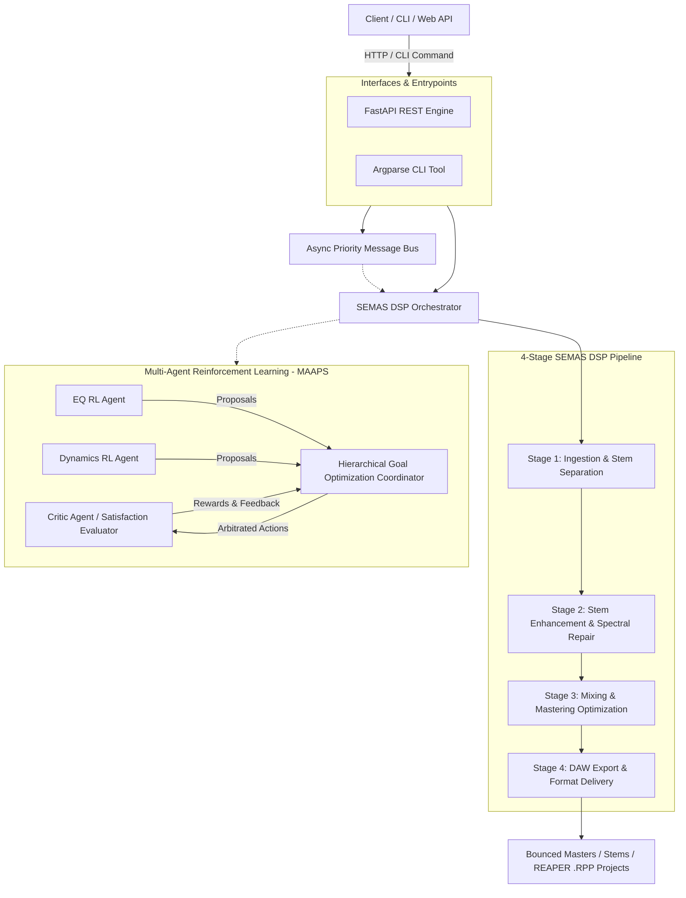

# ETHOS Core

[](https://github.com/ethos-ai/ethos-core/actions/workflows/ci.yml)
[](https://github.com/ethos-ai/ethos-core/actions/workflows/docker.yml)
[](https://www.python.org/downloads/)
[](https://github.com/astral-sh/ruff)
[](https://github.com/PyCQA/bandit)
[](https://opensource.org/licenses/MIT)

> **Next-Generation Autonomous Audio Intelligence & Multi-Agent DSP Mastering Platform**  
> *Transform raw recordings and AI-generated stems into radio-ready, professional DAW productions through distributed multi-agent signal processing and reinforcement learning.*

---

## Table of Contents

- [Overview](#overview)
- [System Architecture](#system-architecture)
- [Core Capabilities](#core-capabilities)
  - [4-Stage DSP Production Pipeline (21 Specialized Agents)](#4-stage-dsp-production-pipeline-21-specialized-agents)
  - [Multi-Agent Reinforcement Learning (MAAPS & HGO)](#multi-agent-reinforcement-learning-maaps--hgo)
  - [Event-Driven Asynchronous Message Bus](#event-driven-asynchronous-message-bus)
- [Installation & Setup](#installation--setup)
- [Command Line Interface (CLI)](#command-line-interface-cli)
- [REST API Reference](#rest-api-reference)
- [Docker & Kubernetes Deployment](#docker--kubernetes-deployment)
- [Testing & Quality Verification](#testing--quality-verification)
- [Repository Organization](#repository-organization)
- [License](#license)

---

## Overview

**ETHOS Core** is an enterprise-grade audio intelligence platform engineered to bridge the fidelity gap between raw/AI-generated audio and broadcast-ready master recordings. Combining traditional DSP engineering with autonomous multi-agent reinforcement learning, ETHOS analyzes musical structure, separates pristine stems, enhances sonic quality, resolves mix conflicts, and bakes full project hierarchies into digital audio workstations (including Cockos REAPER).

---

## System Architecture



---

## Core Capabilities

### 4-Stage DSP Production Pipeline (21 Specialized Agents)

ETHOS orchestrates 21 focused audio DSP agents partitioned into four sequential production phases:

```
src/ethos/agents/dsp/
├── stage1/  # Ingestion, Analysis & Separation
│   ├── AudioAnalysisAgent       (BPM, key, spectral centroid, sections, dynamic range)
│   ├── StemSeparatorAgent      (Demucs HTDemucs 4-stem isolation: vocals, drums, bass, other)
│   └── MetadataExtractorAgent   (Musical, technical, and structural metadata tagging)
│
├── stage2/  # Stem Enhancement & Restoration
│   ├── QualityEnhancementAgent  (Automated artifact removal & harmonic saturation)
│   ├── TransientShapingAgent    (Drum punch & percussive attack preservation)
│   ├── StereoEnhancementAgent   (Mid/Side widening & psychoacoustic pseudo-stereo)
│   ├── SpectralRepairAgent      (Multi-channel STFT harmonic inpainting & denoise)
│   ├── HarmonicEnrichmentAgent  (Aural exciter & tape warmth)
│   └── DynamicEnhancementAgent  (Multi-band expansion & RMS leveling)
│
├── stage3/  # Mixing & Mastering
│   ├── MixEngineerAgent         (Multi-track balancing, stereo panning & sum bus)
│   ├── MasteringAgent           (LUFS optimization, true-peak brickwall limiting)
│   ├── LoudnessOptimizerAgent   (Targeted EBU R128 / ITU-R BS.1770 normalization)
│   ├── FrequencyBalanceAgent    (Linear-phase EQ curvature balancing)
│   ├── GenreOptimizerAgent      (Profile matching: Pop, Rock, Electronic, Ballad)
│   └── ReferenceMatchingAgent   (Spectral matching against reference master tracks)
│
└── stage4/  # Export & Delivery
    ├── DAWGeneratorAgent        (Automated Cockos REAPER .RPP project generation)
    ├── MarkerCreatorAgent       (Structure markers & section region tags)
    ├── FormatConverterAgent     (Bitrate & format transcoding: WAV, FLAC, MP3, OGG)
    ├── MetadataExporterAgent    (JSON & XML metadata reporting)
    ├── TempoMapAgent            (Tempo maps & click track alignment)
    └── MIDIGeneratorAgent       (Automated click tracks & transcription MIDI)
```

### Multi-Agent Reinforcement Learning (MAAPS & HGO)

For ambiguous mixing decisions where agents disagree (e.g., boosting high frequencies for vocal clarity vs. controlling harshness):
- **Audio Ontology**: Structured semantic knowledge model mapping subjective perceptual attributes (`CLARITY`, `WARMTH`, `PUNCH`, `HARSHNESS`, `MUD`) to actionable DSP frequency bands.
- **Hierarchical Goal Optimization (HGO)**: Conflict resolution coordinator arbitrating competing agent proposals using Pareto optimization and priority weights.
- **Critic Agent**: Neural evaluation network scoring audio states and generating normalized reward gradients `[-1.0, 1.0]` for policy training.

### Event-Driven Asynchronous Message Bus

All agents communicate over a decoupled, in-memory asynchronous publish/subscribe message bus (`ethos.core.message_bus`) supporting priority queues (`CRITICAL`, `HIGH`, `NORMAL`, `LOW`) and pattern/wildcard routing (`analysis.*`, `stage2.complete`).

---

## Installation & Setup

ETHOS Core standardizes on **`uv`** for reproducible, blisteringly fast environment management.

### Prerequisites
- Python `>=3.10, <3.13` (3.12 recommended)
- `uv` package manager (`curl -LsSf https://astral.sh/uv/install.sh | sh` or `winget install astral-sh.uv`)
- `libsndfile` and `ffmpeg` (for multi-format audio I/O)

### Install Dependencies

```bash
# Clone the repository
git clone https://github.com/ethos-ai/ethos-core.git
cd ethos-core

# Sync virtual environment with development dependencies
uv sync --extra dev
```

---

## Command Line Interface (CLI)

The unified `ethos` CLI exposes quick-action workflows directly from the terminal:

### 1. Analyze Audio File
Inspect duration, sample rate, BPM, key, dynamic range, and section boundaries:
```bash
uv run ethos analyze path/to/track.wav
```

### 2. Full 4-Stage DSP Processing
Execute stem separation, restoration, mixing, mastering, and REAPER project generation:
```bash
uv run ethos process input_track.wav \
  --output ./production_output \
  --profile aggressive \
  --format streaming \
  --daw reaper
```

### 3. Launch REST API Server
```bash
uv run ethos serve --host 0.0.0.0 --port 8000
```

---

## REST API Reference

When launched via `ethos serve`, the FastAPI backend exposes interactive OpenAPI documentation at `http://localhost:8000/docs`.

### Core Endpoints

| Method | Endpoint | Description |
|---|---|---|
| `GET` | `/` | API version and platform status |
| `GET` | `/health` | Liveness/readiness probe (reports 21 active DSP agents) |
| `POST` | `/analyze` | Multipart audio upload for instant Stage 1 feature extraction |
| `POST` | `/process` | Asynchronous end-to-end DSP pipeline job dispatch |
| `GET` | `/jobs` | List recent audio processing jobs and completion states |
| `GET` | `/jobs/{job_id}` | Retrieve individual job status, metrics, and output paths |

---

## Docker & Kubernetes Deployment

### Docker Compose (Local Dev)
```bash
docker compose up --build ethos-core
```

### Production Kubernetes Manifests
Production deployment assets reside in `deployment/k8s/`:
```bash
kubectl apply -f deployment/k8s/configmap.yaml
kubectl apply -f deployment/k8s/deployment.yaml
kubectl apply -f deployment/k8s/service.yaml
kubectl apply -f deployment/k8s/hpa.yaml
```

---

## Testing & Quality Verification

ETHOS Core maintains strict quality gates across formatting, typing, security, and test coverage:

```bash
# 1. Code Style & Formatting
uv run ruff check .
uv run ruff format --check .

# 2. Static Type Analysis
uv run mypy src/ethos/core

# 3. Security Vulnerability Audit
uv run bandit -r src/ethos -lll

# 4. Comprehensive Test Suite (Unit + Integration)
uv run pytest --cov=src/ethos --cov-report=term-missing tests/
```

---

## Repository Organization

```
ethos-core/
├── .github/
│   ├── workflows/
│   │   ├── ci.yml            # Multi-OS matrix CI, quality gates, test coverage
│   │   ├── docker.yml        # Docker build and Trivy container security scanner
│   │   └── release.yml       # Release wheel distribution and GitHub release
│   └── dependabot.yml        # Automated dependency updates
├── deployment/
│   └── k8s/                  # Kubernetes Deployment, Service, ConfigMap, HPA
├── docs/
│   ├── deployment/           # Docker and container operational documentation
│   └── vision/               # Theoretical foundations, mastering models, and whitepapers
├── src/
│   └── ethos/
│       ├── core/             # Ontology, message bus, data structures, configs
│       ├── agents/
│       │   ├── dsp/          # 21 DSP stage agents + unified orchestrator
│       │   ├── infra/        # Distributed Ray cluster resource manager
│       │   └── rl/           # Critic, EQ, Dynamics, and HGO RL agents
│       └── interfaces/       # FastAPI REST API and command-line interface
├── tests/
│   ├── unit/                 # Atomic test coverage for all stages and modules
│   └── integration/          # End-to-end synthetic audio pipeline test
├── Dockerfile                # Multi-stage container definition (Python 3.12, uv, non-root)
├── docker-compose.yml        # Local container orchestration
└── pyproject.toml            # PEP 621 build definition & tool configurations
```

---

## License

This project is licensed under the MIT License — see the [LICENSE](LICENSE) file for details.
