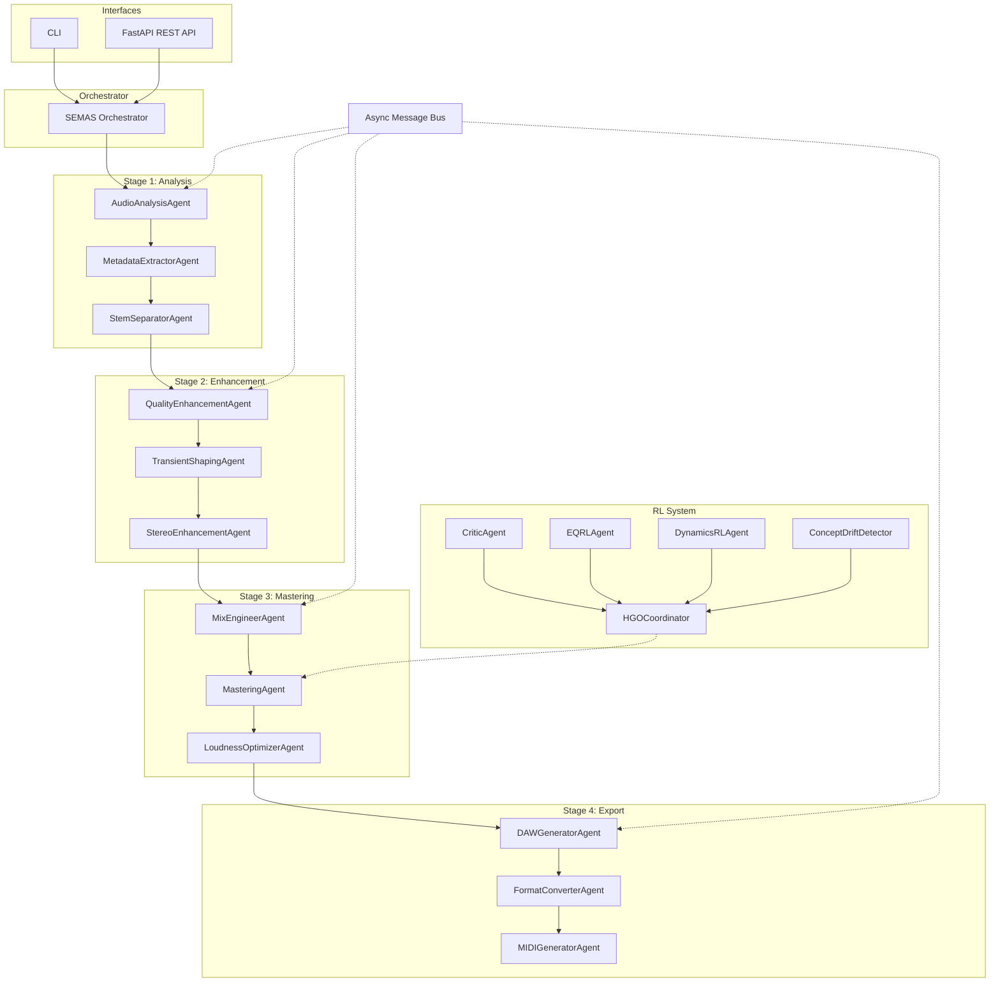

# System Architecture

## Overview

ETHOS Core is a modular, event-driven audio intelligence platform built on a cooperative multi-agent architecture. All agents communicate through an asynchronous priority message bus with W3C trace context propagation.

## Core Components

| Component | Module | Purpose |
|-----------|--------|---------|
| **SEMAS Orchestrator** | `ethos.agents.dsp.orchestrator` | Initializes and sequences all 21 agents |
| **Message Bus** | `ethos.core.message_bus` | Async pub/sub with priority queues and trace context |
| **Audio Ontology** | `ethos.core.ontology` | Domain model for audio attributes, goals, and actions |
| **Data Structures** | `ethos.core.data_structures` | Shared types: AudioStem, StemCollection, SEMASJob |
| **Configuration** | `ethos.core.config` | Environment-aware settings via Pydantic |

## Technology Stack

| Layer | Technology |
|-------|-----------|
| Language | Python 3.12 |
| Web Framework | FastAPI + Uvicorn |
| Distributed Computing | Ray |
| ML/RL | PyTorch |
| Audio Processing | librosa, soundfile, scipy |
| Lint & Format | Ruff |
| Type Checking | Mypy |
| Security | Bandit |
| Package Management | uv (Astral) |
| Containerization | Docker + Kubernetes |

## Design Principles

1. **Event-Driven** — Agents communicate via message bus, not direct calls
2. **Async-First** — All I/O-bound operations are async
3. **Modular Agents** — Each agent has a single responsibility
4. **Safe by Default** — Drift detection with automatic Safe Mode fallback
5. **Observable** — W3C trace context, Prometheus metrics, structured logging
