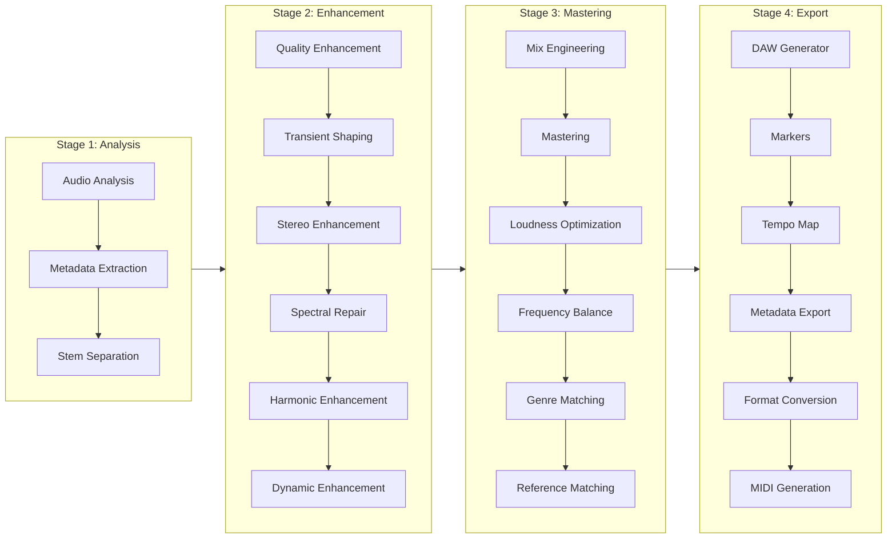

# DSP Pipeline

The ETHOS DSP pipeline processes audio through 4 sequential stages, each containing specialized agents.

## Stage 1: Analysis

The analysis stage extracts all audio features needed by downstream agents:

- **BPM** — Tempo detection via onset strength envelope
- **Key & Scale** — Chromagram-based tonal analysis
- **Genre** — Spectral feature classification
- **Loudness** — Integrated LUFS, true peak, dynamic range
- **Sections** — Verse/chorus/bridge boundary detection
- **Stems** — Source separation into vocals, drums, bass, other

## Stage 2: Enhancement

Enhancement agents improve audio quality on individual stems:

- **Noise Reduction** — Spectral gating and denoising
- **Transient Shaping** — Attack/sustain envelope modification
- **Stereo Imaging** — Width and correlation adjustments
- **Spectral Repair** — Gap filling and artifact removal
- **Harmonic Enrichment** — Saturation and overtone generation
- **Dynamic Enhancement** — Compression and expansion

## Stage 3: Mastering

Mastering agents produce the final mix:

- **Mix Balance** — Stem level and pan optimization
- **Mastering Chain** — EQ, multiband compression, limiting
- **Loudness Targeting** — LUFS-integrated normalization to target (-14 LUFS default)
- **Genre Matching** — Style-appropriate processing profiles
- **Reference Matching** — Tonal profile matching to reference tracks

## Stage 4: Export

Export agents produce deliverable assets:

- **REAPER .RPP** — Full project with tracks, markers, routing
- **SVG Visualizations** — EQ frequency response and dynamics transfer curves
- **Format Conversion** — WAV, FLAC, MP3 output
- **MIDI Generation** — Melodic/rhythmic MIDI representations
- **Metadata Embedding** — ID3, Vorbis comment, BWF tags

## Message Bus Events

Agents communicate via the async message bus with topic-based routing:

| Event | Publisher | Subscribers |
|-------|-----------|-------------|
| `analysis.complete` | AudioAnalysisAgent | All Stage 2 agents |
| `enhancement.complete` | Stage 2 agents | MixEngineerAgent |
| `mastering.complete` | MasteringAgent | DAWGeneratorAgent |
| `daw.project.generated` | DAWGeneratorAgent | MetadataExporterAgent |
