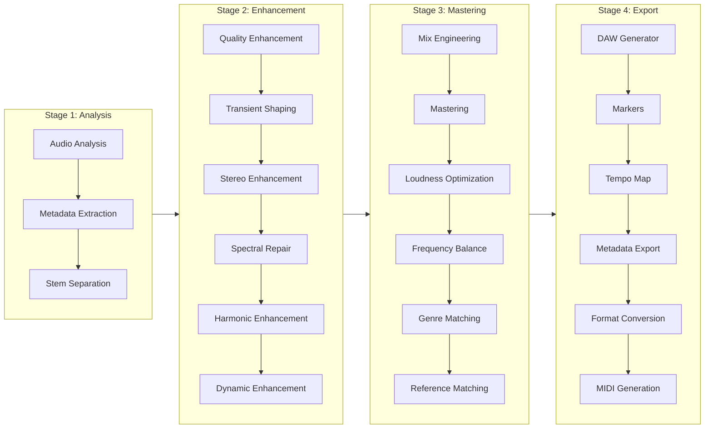

# DSP Pipeline

The ETHOS DSP pipeline processes audio through 4 sequential stages, each containing specialized agents.

## Stage 1: Analysis

Stage 1 works out the features the later stages use:

- **BPM**: tempo from the onset strength envelope.
- **Key and scale**: tonal analysis from a chromagram.
- **Genre**: a rule of thumb based on tempo and spectral features (Ballad / Pop midtempo / Pop uptempo and so on). It isn't a trained classifier.
- **Loudness**: RMS − 23 dB, stored as "LUFS". There's no K-weighting and no gating, so it isn't EBU R128 / BS.1770. The `true_peak_db` field holds the sample peak; there's no oversampling. Dynamic range is peak minus RMS.
- **Sections**: verse/chorus/bridge boundary estimates.
- **Stems**: Demucs `htdemucs`, but only if Demucs is installed. It isn't a dependency.

## Stage 2: Enhancement

Each stem gets simple NumPy/SciPy processing:

- **Transient shaping**: transient/sustain split from a Hilbert envelope.
- **Stereo**: mid/side width. A mono signal becomes pseudo-stereo with a 1 ms delay.
- **Spectral repair**: the STFT magnitude is blended 70/30 with a smoothed copy. There's no real gap filling or artifact detection.
- **Harmonic enrichment**: `tanh` saturation plus a high-passed `tanh` exciter.
- **Dynamics**: sample-wise static compression/expansion, with no attack or release.

## Stage 3: Mix and master

- **Mix**: template parameters. Every stem is panned centre.
- **Mastering**: a 30 Hz high-pass, sample-wise compression, an `np.clip` limiter, then RMS-based gain. The gain comes after the clip, so the ceiling can be exceeded.
- **Frequency balance**: one 2nd-order 20 Hz Butterworth high-pass. It isn't linear-phase.
- **Genre profile**: broadband gain changes.
- **Reference matching**: RMS level only. There's no tonal matching.

The full per-agent status table is in the [README](https://github.com/sgm-audio/ethos-core#implementation-status).

## Stage 4: Export

- **REAPER .RPP**: a project with tracks and markers.
- **SVG charts**: EQ response and dynamics transfer curves (`core/visualization.py`).
- **Format conversion**: WAV and FLAC via soundfile; MP3 and OGG via an `ffmpeg` subprocess.
- **MIDI**: a click track only. Audio-to-MIDI transcription is a placeholder.
- **Metadata**: JSON and XML reports. Nothing is embedded in the audio files.

## Message Bus Events

Agents communicate via the async message bus with topic-based routing:

| Event | Publisher | Subscribers |
|-------|-----------|-------------|
| `analysis.complete` | AudioAnalysisAgent | All Stage 2 agents |
| `enhancement.complete` | Stage 2 agents | MixEngineerAgent |
| `mastering.complete` | MasteringAgent | DAWGeneratorAgent |
| `daw.project.generated` | DAWGeneratorAgent | MetadataExporterAgent |
