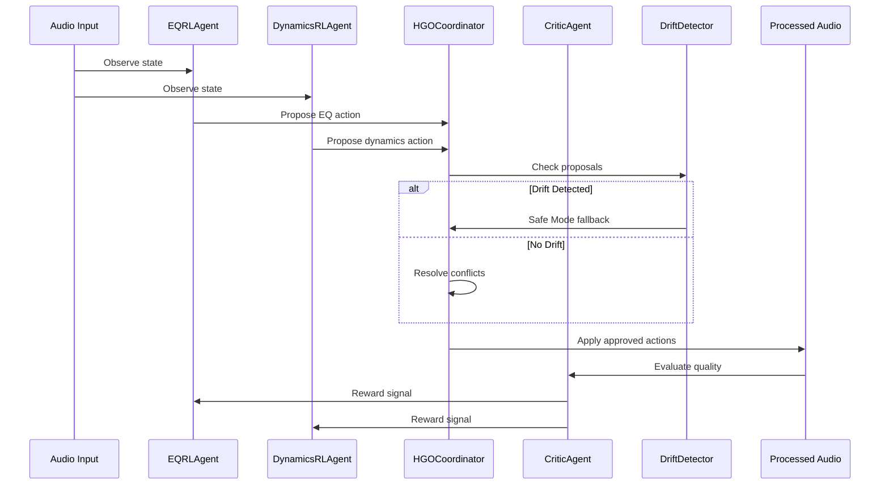

# RL Multi-Agent System

## Overview

ETHOS employs reinforcement learning agents that learn optimal audio processing parameters through iterative evaluation and policy updates. Rather than using fixed DSP recipes, the RL system adapts its processing to each unique audio input.

## CriticAgent

The CriticAgent evaluates processed audio quality using a neural network that scores multiple audio attributes (clarity, warmth, punch, etc.) and computes an overall satisfaction score.

**Architecture:** Multi-layer perceptron with spectral feature inputs (MFCCs, spectral centroid, rolloff, contrast).

## EQRLAgent

Learns parametric EQ parameters (frequency, gain, Q) via policy gradient optimization. The agent proposes EQ adjustments and receives reward signals from the CriticAgent based on the resulting audio quality.

## DynamicsRLAgent

Learns compression and dynamics parameters (threshold, ratio, attack, release, makeup gain) through the same policy gradient framework.

## HGOCoordinator

The Hierarchical Goal Optimization Coordinator mediates between competing agent proposals:

1. **Conflict Detection** — Identifies opposing impacts on shared audio attributes
2. **Goal Scoring** — Ranks proposals against the priority-ordered goal hierarchy
3. **Compromise** — Scales down conflicting parameters when severity is moderate
4. **Execution Ordering** — EQ before dynamics (frequency content affects dynamics behavior)

## Training Loop

1. Agents observe the current `AudioState`
2. Agents propose `AgentAction` with predicted impacts
3. HGOCoordinator resolves conflicts and determines execution order
4. Actions are applied to audio
5. CriticAgent evaluates the result and provides reward
6. Agents update their policies via gradient descent
